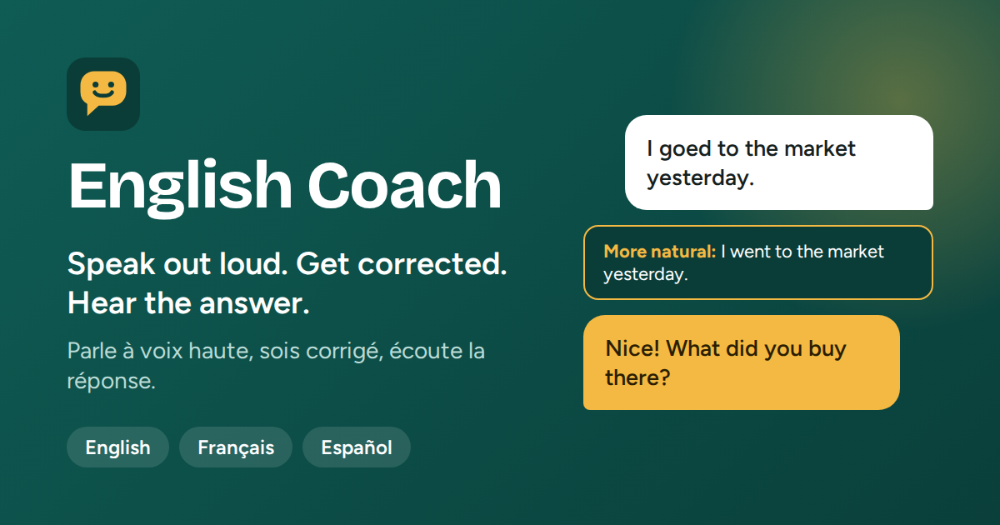

# English Coach AI

<p align="center"></p>

A private language coach that runs on your own computer. No subscription, no paid API, and your conversations stay on your machine.

Call your coach and talk: it speaks first, you answer, it corrects you and keeps going. It also teaches from zero with a step-by-step course. You can learn **English, French or Spanish**, from absolute beginner (A0) to near-native (C2). The interface is in French and English.

## What it does

| | |
| --- | --- |
| **Course** | A beginner path in 10 units (greetings, introductions, numbers, food, directions...). Each lesson: discover the phrases, repeat them aloud, read a dialogue, take a quiz. Works for any language, starting from zero. |
| **Talk** | Free conversation about anything. Every sentence you say is corrected first, then the coach answers, out loud if you want. Situations: meeting someone, everyday life, PhD or job interview, debate, presenting your work, science talk. |
| **Call** | A phone-style voice call. The coach speaks first, you reply, it corrects and continues. At the end: a review with your main mistakes, useful phrases and a next step. |
| **Ask** | Ask a language question by voice or text ("when do I use however and despite?"). The answer is short: the rule, the exceptions, examples. Read it, hear it, or both. |
| **Voice drills** | Pronunciation (word-by-word score) and dictation. |
| **Write** | Corrected text with each mistake explained. |
| **Understand** | Reading or listening exercises with a quiz. |
| **Studio** | Poems, stories, rewriting in another tone, grammar lessons, idioms, emails and letters, text simplifying, interview preparation, 60-second pitch. |
| **Translate**, **Vocabulary** | Two-way translation; explain, save and review words with spaced repetition. |
| **History and progress** | Every conversation is saved and can be reopened. Daily streak and activity per skill. |

The model is text-only. Voice works through a pipeline: your speech is turned into text (browser or Whisper), the model answers, and the answer is read aloud (browser voice or Piper). Expect a short pause between turns.

## How it fits together

```
Browser ── SvelteKit (pages + proxies) ── FastAPI ── Ollama (Qwen3)
                                              └──── SQLite or Postgres
```

## Install

You need Python 3.11+, Node.js 20+ and [Ollama](https://ollama.com/download). Use Chrome or Edge for the microphone.

```bash
# 1. The model (about 2.5 GB, once)
ollama pull qwen3:4b

# 2. Everything the backend needs (from the project root)
python -m venv .venv
.venv\Scripts\activate              # macOS/Linux: source .venv/bin/activate
pip install -r requirements.txt

# 3. Start the backend
cd backend
cp .env.example .env                # Windows: copy .env.example .env
uvicorn app.main:app --reload       # API docs: http://127.0.0.1:8000/docs

# 4. Start the frontend (second terminal)
cd frontend
cp .env.example .env
npm install
npm run dev                         # http://localhost:5173

# Optional: a Postgres database in Docker (SQLite is used if you skip this)
docker compose up -d db
```

The `docker compose` line starts a Postgres database in a container, so nothing is installed on your machine. It only matters if you switch the database (see [Database](#database-sqlite-or-postgres)).

After updating the project files, run `pip install -r requirements.txt` and `npm install` again. If something fails, see `backend/README.md` for the diagnostic tool.

The badge at the bottom of the sidebar shows whether the server, Ollama and the model are ready. The first launch asks for your name, the language you want to learn, the interface language and your level.

## Voice

**Talk**, **Call**, **Ask** and the voice drills use the microphone. Press the voice button, allow the microphone, and speak. Silence ends your turn automatically; three silent turns in a row pause the call.

The app has two voice engines, and you switch between them simply by installing or removing one optional package set:

| | Browser voice (default) | Local voice (Whisper + Piper, optional) |
| --- | --- | --- |
| Hears you | The browser's speech recognition: Microsoft servers on Edge, Google servers on Chrome | **Whisper**, running on your computer |
| Speaks | The voices installed in Windows and the browser | **Piper**, running on your computer |
| Install | Nothing | `requirements-speech.txt` |
| Your audio | Sent to the browser vendor | Never leaves your machine |
| Quality | Good. On Edge, pick a "Natural" voice in Settings (for example "Microsoft Aria Online (Natural)"): it is usually the best free voice | Whisper often understands a non-native accent better. Piper sounds good but is not better than Edge's Natural voices; its benefit is working offline |
| Languages | All | Whisper: all. Piper: the English voice below only; other languages keep the browser voice |

### Why the second requirements file exists

`requirements.txt` is everything the app needs to run. `requirements-speech.txt` is separate on purpose: it adds Whisper and Piper, which are heavy and can fail to install on some Windows and Python combinations. Keeping them apart means a failed speech install can never stop the app from starting. It also means that, until you install it, **the app uses your browser's default voice and recognition**. Installing it replaces that default with Whisper and Piper.

### Turn on the local voice

```bash
pip install -r requirements-speech.txt
python -m piper.download_voices en_US-lessac-medium --data-dir backend/models/piper
```

Restart the backend. Settings shows "Whisper and Piper: Active" when both work. If the download command differs for your Piper version, put `en_US-lessac-medium.onnx` and its `.json` file in `backend/models/piper/`.

**First launch.** The first time you use the microphone, Whisper downloads its model (about 500 MB for the default `small`). This takes a few minutes, once; after that it is cached and starts in seconds. The first answer after each backend restart is a little slower while the model loads.

**GPU.** Whisper can use your NVIDIA graphics card, which makes it much faster. With `WHISPER_DEVICE=auto` (the default in `backend/.env`) it tries the GPU first. If the NVIDIA CUDA libraries are not available, it falls back to the processor automatically, which works but is slower. You can force a choice with `WHISPER_DEVICE=cuda` or `cpu`, and a different size with `WHISPER_MODEL` (`base` is lighter, `medium` is more accurate). Piper runs on the processor and needs no GPU, which leaves the graphics card to the language model.

### Go back to the browser voice

```bash
pip uninstall faster-whisper piper-tts
```

Restart the backend. Nothing else changes: the app detects what is installed and switches back by itself.

## Profiles and privacy

Each person picks a first name, and every profile has its own history, progress and words. There is no password: fine for you and people you trust on the same machine or network. Add real authentication before exposing the app to the internet.

## Database: SQLite or Postgres

The app stores conversations, progress and words in a database. You pick which one with a single line in `backend/.env`:

| `DB_MODE` | What it uses | Needs |
| --- | --- | --- |
| `sqlite` (default) | One file, `backend/data/english_coach.db` | Nothing. Best for one person |
| `postgres` | A Postgres server | `docker compose up -d db` (Docker runs Postgres for you). Better for several people |

To switch, change `DB_MODE` in `backend/.env` and restart the backend. The `POSTGRES_*` values already match `docker-compose.yml`. Each database keeps its own data: switching does not copy anything, and switching back brings your previous data back. Tables, and new columns after an update, are created at startup.

## Adding things

Everything is described in small catalogs in `backend/app/catalog/`. Add one entry and it appears in the app, in both interface languages, with no frontend change:

| To add | Edit | What to write |
| --- | --- | --- |
| A Studio module | `tools.py` | One `Tool(...)`: titles, instructions for the model, optional choices |
| A conversation situation | `scenarios.py` | One `Scenario(...)`: label, prompt, first line per language |
| A conversation topic | `topics.py` | One `Topic(...)`: label, first line per language |
| A course unit | `units.py` | One `Unit(...)`: title, goal, what it teaches. It works in every language |
| A language | `languages.py` | One `Language(...)` with `available=True`. Add its first lines in `scenarios.py` and `topics.py` (English is used when missing) |

Languages marked `available=False` (German, Portuguese, Italian, Chinese, Arabic) show as "soon". Quality depends on the model: English is the strongest, French and Spanish are good, and a larger model such as `qwen3:8b` (set `OLLAMA_MODEL`) improves them.

## Publishing

- `frontend/static/` holds the favicon, app icons, `og.png` (the link preview image), `site.webmanifest` and `robots.txt`.
- For a production build (`npm run build && npm start`), set `ORIGIN` to your public address (for example `ORIGIN=https://coach.example.com`), otherwise link previews and form protection use the wrong address.
- Before sharing publicly, add authentication (see Profiles above).

## Growing it

- Several people: raise `MAX_CONCURRENT_GENERATIONS` and set `OLLAMA_NUM_PARALLEL` on Ollama if the GPU allows it, or run Ollama on a stronger machine and set `OLLAMA_BASE_URL`.
- The backend keeps no state in memory, so you can run several copies behind a load balancer once you use Postgres.
- Next steps: real accounts, Alembic migrations, a learning timeline.

## License

MIT